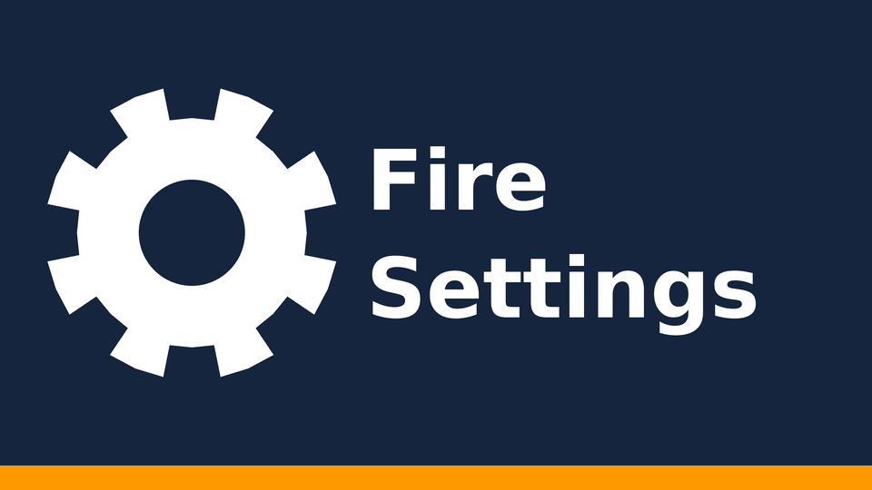

<p align="center">
  
</p>

<p align="center">
  <b>Opens the full Fire TV settings screen from any launcher.</b><br>
  For Projectivy Launcher and other Fire TV home-screen replacements.
</p>

<p align="center">
  <a href="https://github.com/Sternpaul/fire-settings/releases/latest"></a>
  <a href="https://github.com/Sternpaul/fire-settings/actions/workflows/build.yml"></a>
  
  
  <a href="LICENSE"></a>
</p>

---

## The problem

If you use a third-party launcher like **Projectivy** on a Fire TV, its "Android settings" button just flashes and
takes you back. Fire OS sends the standard `android.settings.SETTINGS` intent to Amazon's home screen, and the
launcher intercepts that and returns you home.

## The fix

**Fire Settings** is a tiny app with a TV banner. Pin it to your home row, press it, and you get the real Fire TV
settings screen.

- **No UI:** it opens settings and closes in the same moment, so nothing flashes on screen.
- **No permissions and no tracking.** The app is about 30 lines of Java.
- **Fallback:** if Amazon's settings screen isn't there, it opens the standard Android settings screen instead.

## Install

1. Download `FireSettings-vX.Y.apk` from the [latest release](https://github.com/Sternpaul/fire-settings/releases/latest).
2. Install it with ADB:

   ```bash
   adb connect <fire-tv-ip>
   adb install -r FireSettings-v1.0.apk
   ```

   Or install it with a sideloading app such as *Downloader*.
3. In Projectivy (or your launcher), add **Fire Settings** to your home row.

It runs on Fire OS 5 and newer (minSdk 22). It has been confirmed on a current Fire TV Stick with Projectivy Launcher.

## How it works

The app has one Activity with `Theme.NoDisplay`. It launches

```
com.amazon.tv.launcher/.ui.MainSettingsActivity
```

with `FLAG_ACTIVITY_NEW_TASK`. If that fails, it falls back to `android.settings.SETTINGS`. Then it calls
`finish()`. That's the whole app: [`MainActivity.java`](src/local/firesettings/MainActivity.java).

To check that the target screen exists on your device:

```bash
adb shell am start -n com.amazon.tv.launcher/.ui.MainSettingsActivity
```

## Build from source

No Gradle and no Android Studio. The build uses plain `javac`, `dx`, `aapt`, `zipalign` and `apksigner` from
Ubuntu's own packages, so it also builds **natively on ARM64** (for example a Raspberry Pi or an Oracle Ampere
server), where Google's SDK build-tools don't run.

```bash
sudo apt install openjdk-17-jdk-headless aapt apksigner zipalign dalvik-exchange android-sdk-platform-23
./build.sh
```

The output is `out/FireSettings.apk`.

> [!IMPORTANT]
> On the first run, `build.sh` creates a signing key in `keystore/` (git ignores it). **Back it up.**
> Android only installs an update over an existing install when both are signed with the same key.

The icon and banner are drawn by [`tools/make_images.py`](tools/make_images.py) (needs Pillow):

```bash
python3 tools/make_images.py res/drawable-xhdpi docs
```

## Project layout

```
├── AndroidManifest.xml          # LAUNCHER + LEANBACK_LAUNCHER, banner, NoDisplay theme
├── src/local/firesettings/
│   └── MainActivity.java        # the whole app
├── res/drawable-xhdpi/          # 96×96 icon, 320×180 TV banner
├── tools/make_images.py         # generates the icon and banner
├── build.sh                     # Gradle-free build + signing
└── .github/workflows/build.yml  # CI build on every push
```

## Credits

The target activity comes from [dkreye/fire-settings](https://github.com/dkreye/fire-settings), which solves the
same problem. This is an independent minimal rewrite with a Gradle-free build.

## License

[MIT](LICENSE)
